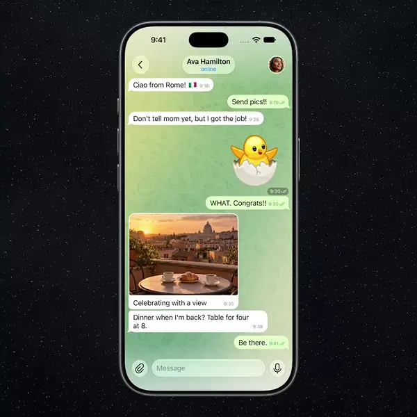

# Black-Hole Delete

**Deleting a chat's history should look as final as it is.**

## Demo

Inline preview is silent — <a href="6.mp4">6.mp4</a> plays the full video with sound.

---

## The idea

An irreversible action should be noticeable, so the user clearly understands they’ve deleted the conversation.

## How it works

- Clear the whole chat history and confirm **Delete for me**.
- The Dynamic Island opens into a black hole with a light ring.
- The wallpaper bends towards it and every visible message is pulled in along an arc, stretching near the horizon (spaghettification).
- The hole lands back into the island with a small spring, and the regular “Chat cleared” toast appears.
- An irreversible action finally reads as one.

## Notes

Pure UIKit + Metal, no SwiftUI, no dependencies, iOS 15+. `BlackHoleDelete/` is a drop-in Telegram-iOS module (`submodules/TelegramUI/Components/Chat/BlackHoleDelete`); the shader is compiled into `default.metallib` inside a resource bundle. Geometry and timing (hole shape at time `t`) live in `BlackHoleTimeline.swift`, the public API in `BlackHoleDeleteAnimator.swift` — three Metal views and one `CADisplayLink`.

> The upstream README is kept as `README.upstream.md` (build/setup instructions).

## Source

Ported from [`riveauxmia/telegram-black-hole-delete`](https://github.com/riveauxmia/telegram-black-hole-delete) (branch `main`). All rights to the original code stay with its authors.
