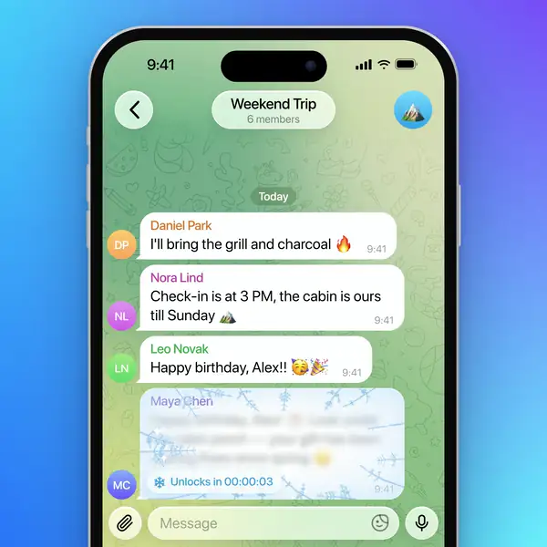

# Time Capsule

**A message that stays sealed until the moment you choose.**

## Demo

Inline preview is silent — <a href="1.mp4">1.mp4</a> plays the full video with sound.

---

## The idea

Hold Send to lock a message until a time you choose. Until then, it stays frosted over with a live countdown, and when the time comes, the frost melts away to reveal the text. Perfect for birthdays, surprises, and promises.

## How it works

- **Hold Send.** Instead of tapping, hold the send button — the send menu opens with **Time Capsule**.
- **Pick the moment.** In an hour, tomorrow, in a week or New Year are one tap; any other date and time comes from the picker.
- **Sealed.** The message appears in the chat as glass: frosted, with snowflakes drifting at the edges, blurred text behind it and a live countdown under it.
- **The melt.** When the moment arrives the frost melts away in about 1.3 s, the countdown collapses and the bubble becomes an ordinary message.
- **Live state.** The countdown ticks against server time, so every client that opens the chat shows the same moment.
- The sender watches their own capsule freeze over right after sending.

## Notes

Telegram Web A fork (`teact`, no external UI framework), branch `time-capsule`. The frost is a `<canvas>` scene — `sealed → opening → open` — driven by a 1 s tick in `TimeCapsule.tsx`; the composer hook lives in `CustomSendMenu.tsx` / `Composer.tsx`.

> The upstream README is kept as `README.upstream.md` (build/setup instructions).

## Source

Ported from [`rouk69/telegram-tt`](https://github.com/rouk69/telegram-tt) (branch `time-capsule`). All rights to the original code stay with its authors.
