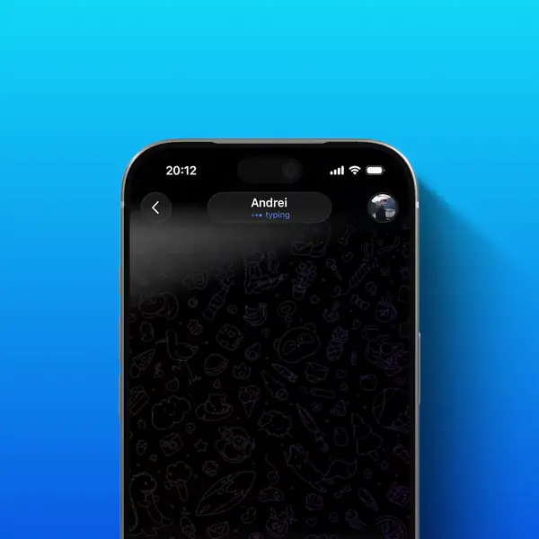

# Visual Quote

**Reply to a detail of a photo, not to the whole photo.**

## Demo

Inline preview is silent — <a href="5.mp4">5.mp4</a> plays the full video with sound.

---

## The idea

Select any area of a photo and reply directly to it. Your reply highlights the selected detail, and tapping it opens the original photo zoomed in. No annotations or extra images needed.

## How it works

1. Open a photo in the full-screen gallery and hold a finger on a detail.
2. A frame appears around it — object separation suggests the frame around the object under the finger, and falls back to the touch point when nothing confident is found. The rest of the photo is dimmed.
3. Adjust the frame: drag a corner to resize, drag inside it to move it. Two fingers still zoom and pan the photo while the frame stays on the same part of it. Hold elsewhere to select another detail, tap outside to clear.
4. Tap **Reply** — the reply panel shows the fragment with the title “Reply to Quote from <name>”, the keyboard opens, and the message goes out as an ordinary reply to the photo with the region attached.
5. Both sides see the fragment in the reply header, styled like a text quote: sender colour, bar, name, quote icon, then the fragment instead of quoted text.
6. Tapping the header opens the original photo zoomed to the region, everything else dimmed, the highlight following zoom and scroll until the gallery closes.
- No annotated copy of the photo is sent — only the region travels with the message.

## Notes

Full Telegram-iOS checkout on branch `visual-quote`. The feature sits behind a Debug Settings switch, “Visual Quote” (`ExperimentalUISettings.visualQuote`), on by default in this build; tap the Settings tab icon ten times quickly to reach Debug Settings. Submodules are **not** vendored in this folder (13 of them, multi-GB) — init them from upstream before building. Details: `docs/visual-quote/README.md`.

> The upstream README is kept as `README.upstream.md` (build/setup instructions).

## Source

Ported from [`xntaylerx-lab/Telegram-iOS`](https://github.com/xntaylerx-lab/Telegram-iOS) (branch `visual-quote`). All rights to the original code stay with its authors.
