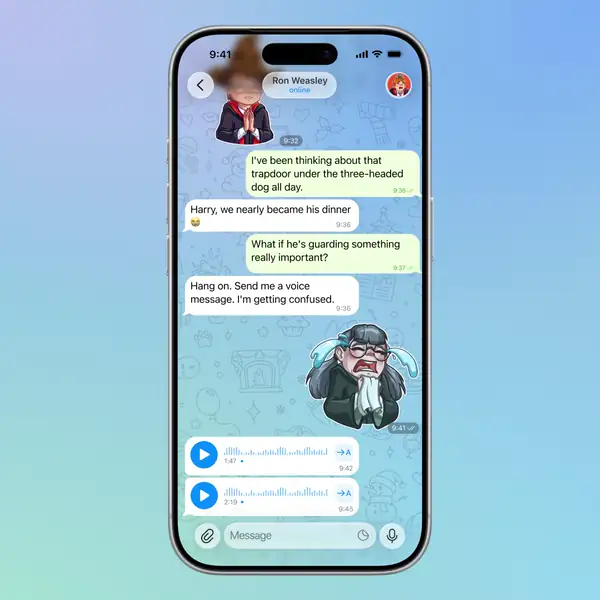

# Voice Innovation

**Voice messages you can finally work with.**

## Demo

Inline preview is silent — <a href="7.mp4">7.mp4</a> plays the full video with sound.

---

## The idea

We’ve all been in situations where we’ve received long voice messages. Maybe your manager dictated a bunch of tasks, a friend shared a story, or a classmate sent a lecture recording. And often, you need to do more than just listen — you need to find something important, jot down a thought, or respond to something that was said. And that’s where things get frustrating. You replay the voice message, skip back and forth, trying to remember where something specific was mentioned. And when you want to respond to a particular moment, you have to explain exactly what you’re referring to. Transcription partially solves this problem. But simply having the text isn’t enough. Quickly finding what you need, jumping to that moment in the audio, or quoting what was said is still inconvenient. What if we turned transcription into a fully functional tool for working with voice messages?

Imagine tapping on a voice message and opening a dedicated interface where audio and text work together. The transcript syncs with playback, highlighting words in real time. Tap any word, and you’ll jump straight to that moment in the audio. You can search for a specific phrase, select text, copy it, translate it, or quote it in a reply with an exact timestamp. But what if you don’t have time to go through a long transcript? That’s where AI Summary comes in: key takeaways, questions, and tasks, all in one place. Each item has a timestamp, so you can jump straight to the relevant moment in the recording.

As a result, you can interact with voice messages just as easily as with regular text, instead of simply listening to them from beginning to end.

## How it works

- Tap the playback panel at the top of a chat while a voice message plays — a sheet opens with two tabs: **Transcript** and **AI Summary**.
- The transcript follows playback and highlights words in real time; tap any word to jump to that moment in the audio.
- Search the transcript, select, copy, translate, or quote a passage in a reply with an exact timestamp.
- **AI Summary** lists key takeaways, questions and tasks, each with a timestamp that jumps into the recording.

## Notes

A redesigned transcript sheet for Telegram-iOS. Files: `VoiceTranscriptScreen/`, plus `changes.patch` with the changes to existing client files.

> The upstream README is kept as `README.upstream.md` (build/setup instructions).

## Source

Ported from [`patsoooo/telegram-voice-transcription`](https://github.com/patsoooo/telegram-voice-transcription) (branch `main`). All rights to the original code stay with its authors.
